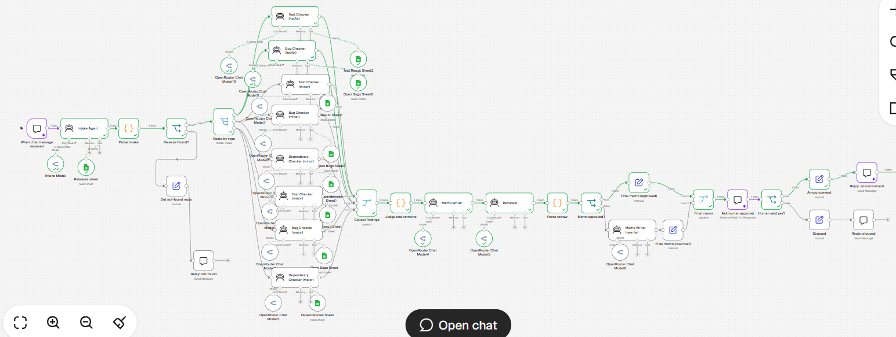

# Release Readiness Desk (n8n multi-agent workflow)

A multi-agent n8n workflow that answers the question "Are we ready to ship?" for a release.

A person types a release request in chat. The workflow checks the release against a company release policy, writes a recommendation memo (**GO**, **GO WITH CONDITIONS** or **NO-GO**), has the memo reviewed by a second agent, and asks a human to approve it before a simulated announcement is sent.

Built as the Week 3 assignment of *Agentic AI for PMs and TPMs*.

> Datasets and release policy are from the course assignment and are included for learning and testing purposes.



## How it works

1. **Intake agent** reads the `releases` tab and finds the release and its type (hotfix, minor or major) from what the user typed. If the release does not exist, it says so and the workflow stops.
2. **Router** (Switch node) sends each release type down its own path.
3. **Parallel checks**: three agents run side by side, each reading its own sheet tab:
   - Test Checker (`test_results`)
   - Bug Checker (`open_bugs`)
   - Dependency Checker (`dependencies`)

   Hotfixes skip the dependency check, as the policy says.
4. **Code node** merges the findings, recomputes the pass rate from the raw numbers, applies the policy limits for the release type and decides the verdict. The verdict is not left to the model.
5. **Memo Writer agent** writes the readiness memo from the decided findings: a rule table with limits and actual values, plus conditions or what must change.
6. **Reviewer agent** compares the memo with the findings. If it finds a difference, the memo goes back to the Memo Writer for **one** rewrite (no loop).
7. **Human approval**: the memo is shown in chat and a person is asked to approve. Only an exact `yes` sends the simulated announcement. Anything else stops with "Not approved. Nothing was sent."

## Policy summary

A bug counts as open if its status is `Open` or `In progress`. Pass rate = total tests passed / total tests run, across all areas.

| | hotfix | minor | major |
|---|---|---|---|
| Test pass rate (at least) | 95% | 97% | 98% |
| Tests run in total (at least) | none | none | 400 |
| Open Critical bugs (max) | 0 | 0 | 0 |
| Open High bugs (max) | 0 | 2 | 2 |
| Blocked dependency | not checked | not allowed | not allowed |
| At risk dependency | not checked | condition | condition |

- **NO-GO**: any rule is broken.
- **GO WITH CONDITIONS**: no rule is broken, but there are open High bugs or an At risk dependency. Each becomes a condition with an owner.
- **GO**: no rule is broken, no open High bugs, no At risk dependencies.

The full text is in [`data/release_policy.txt`](data/release_policy.txt).

## Repository contents

```
.
├── README.md
├── workflow/
│   └── release-readiness-desk.json   # n8n workflow export
├── data/
│   ├── releases.csv
│   ├── test_results.csv
│   ├── open_bugs.csv
│   ├── dependencies.csv
│   └── release_policy.txt
└── docs/
    └── canvas.png
```

## Setup

1. **Create the Google Sheet.** Make one spreadsheet and import each CSV from `data/` as its own tab (File, Import, Insert new sheet). Name the tabs exactly: `releases`, `test_results`, `open_bugs`, `dependencies`.
2. **Import the workflow.** In n8n, create a new workflow and choose **Import from file**, then select `workflow/release-readiness-desk.json`.
3. **Create credentials** for Google Sheets and for your chat model provider (this build uses OpenRouter), and attach them to the nodes.
4. **Point the sheet nodes at your own spreadsheet.** Open each Google Sheets tool and select your spreadsheet and the matching tab.
5. **Chat Trigger setting.** Open *When chat message received*, then Options, and set **Response Mode** to *Using Response Nodes*.
6. Open the chat and try: `Check release R-402`.

## Test scenarios

| Request | Expected result | Why |
|---|---|---|
| Is Checkout 4.2 ready to ship? | NO-GO | Fraud team dependency is Blocked on a major release |
| Check release R-402 | GO | All tests pass, no open bugs; At risk dependency is not checked for hotfixes |
| Review Search 2.8 for release | GO WITH CONDITIONS | Rules met; 2 open High bugs and an At risk dependency become conditions |
| Can we ship Platform 5.0? | NO-GO | Only 210 tests run; a major needs 400 |
| Is Billing 3.4 ready? | NO-GO | An In progress Critical bug still counts as open |
| Check Notifications 1.9 | GO | All rules met, only a Low bug, nothing At risk |
| Review Reports 4.0 | GO WITH CONDITIONS | Rules met; 2 open High bugs and an At risk dependency become conditions |
| Check Login 2.3.1 | NO-GO | Pass rate 92.5% is below the 95% a hotfix needs |
| Is release R-999 ready? | Not found | No such release; the workflow says so and stops |

Approval step: answering `yes` sends the simulated announcement; `no` (or anything else) sends nothing.

## Design notes and lessons learned

- **Limits and verdict live in code, not in prompts.** Prompt-only rule checking invented limits (for example 90% and 500) and treated rules within their limits as broken. A Code node now holds the policy table, recomputes the arithmetic and decides the verdict. Agents read data and write text.
- **Narrow the Reviewer's input.** Given the full findings, the Reviewer invented problems and rejected correct memos. Comparing only the release name, verdict, rule rows and conditions made it reliable.
- **Test the Reviewer both ways.** A reviewer that always approves proves nothing, so the workflow was also tested with a deliberately damaged memo to confirm it is rejected and rewritten.
- **Agents can drop data.** The Bug Checker once left out a Medium bug from its list. A more robust design would read the sheet rows directly in n8n and let the agents only explain them.
- **Approval is strict.** Only an exact `yes` announces anything. Typing a new request while an approval is pending is treated as the answer to the approval, so reply before starting a new request.
- **Open question:** should a NO-GO memo be announced to stakeholders, or sent only to the requester?

## Tech

- n8n (Chat Trigger, AI Agent, Switch, If, Merge, Code, Edit Fields, Google Sheets, Chat "Send and Wait for Response")
- OpenRouter chat models
- Google Sheets as the data source

## Licence

Code and workflow: MIT (see [LICENSE](LICENSE)).
Course datasets and the release policy belong to the course and are included for learning and testing purposes.
